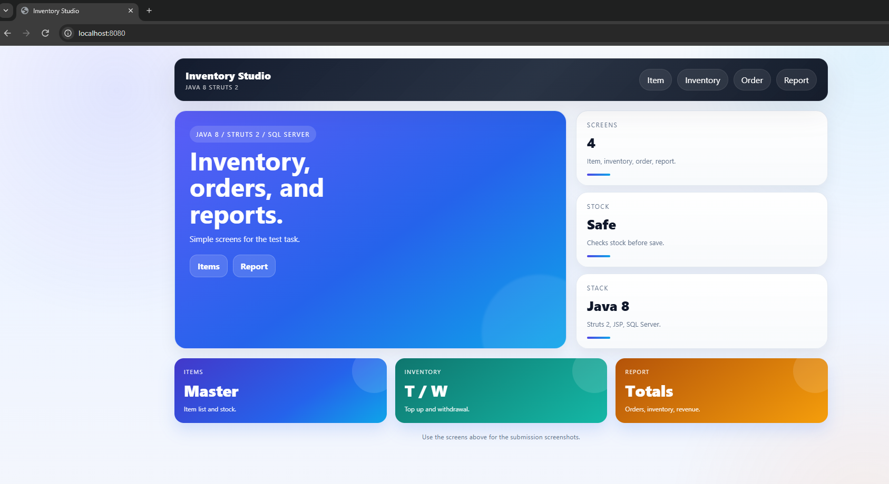
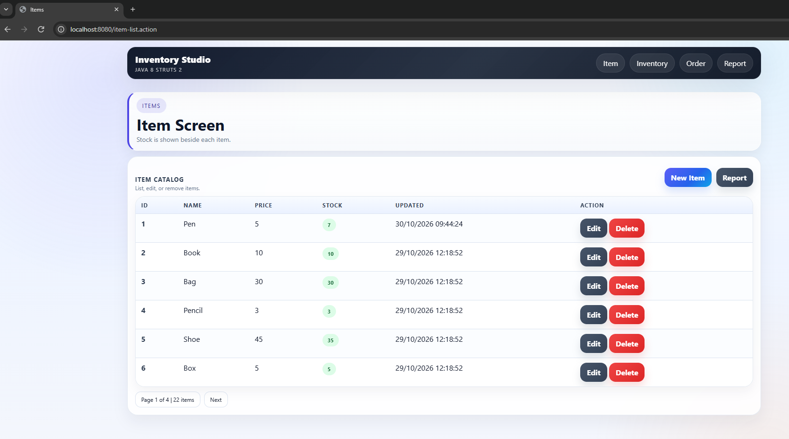
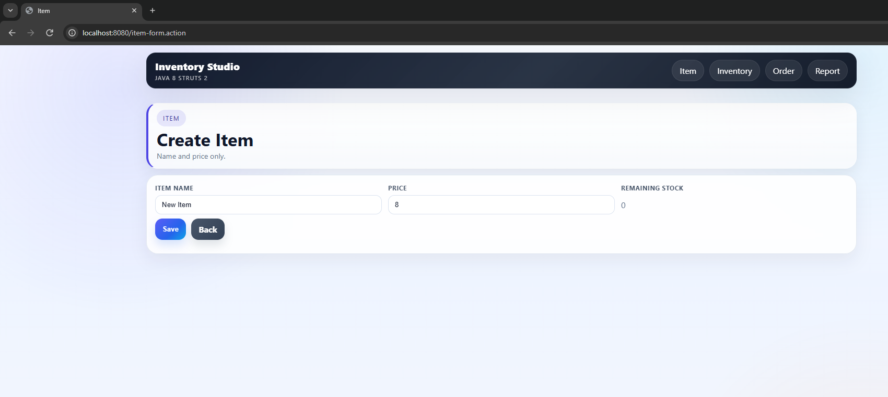
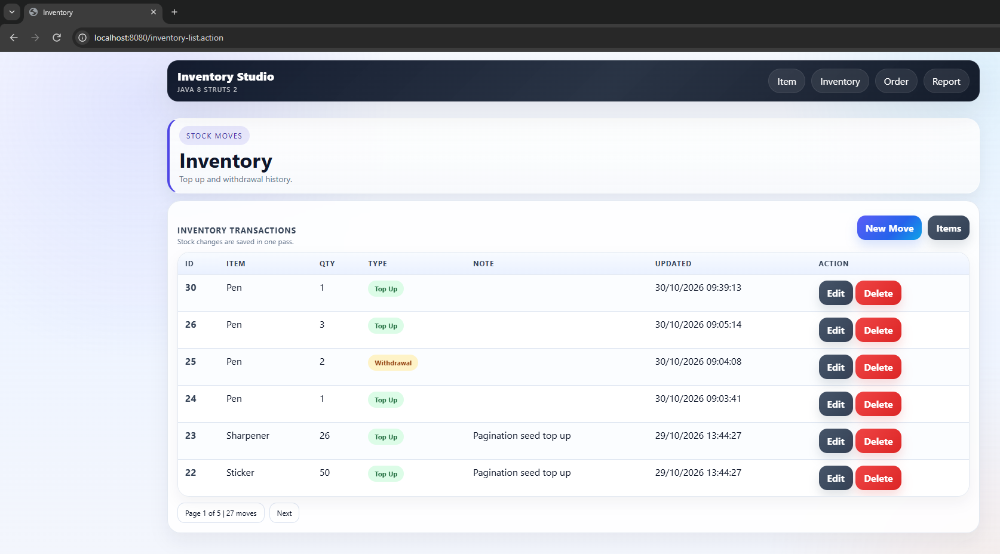
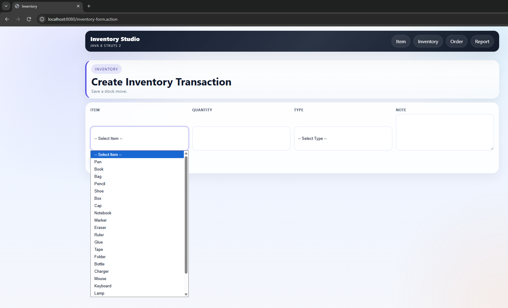
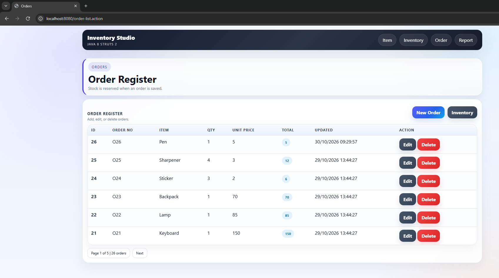
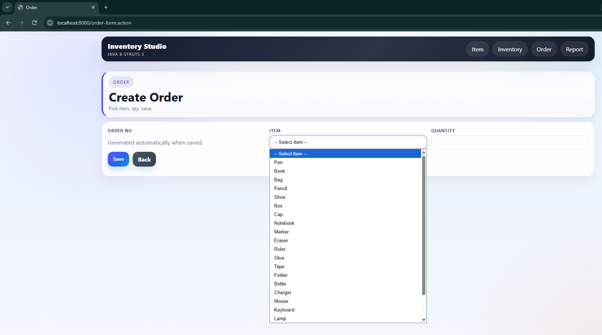
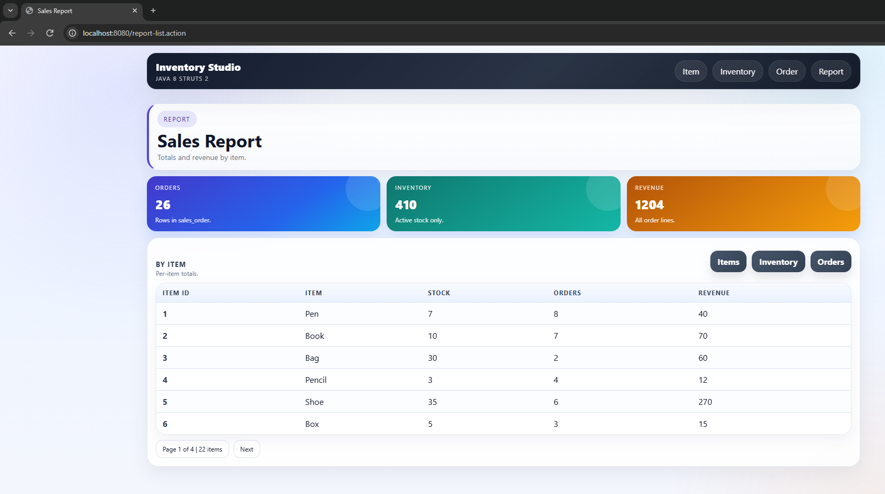

# Java 8 Struts 2 Inventory Test Project

A Java 8, Struts 2, and SQL Server web app for the inventory/order test task.

## Features
- Item CRUD with remaining stock.
- Inventory CRUD for `T` (Top Up) and `W` (Withdrawal).
- Order CRUD with stock validation and insufficient stock handling.
- Auto-generated order numbers.
- Report screen for total orders, total inventory, and revenue by item.
- One SQL script for schema, sample data, pagination demo data, and the report query.
- JUnit tests for the stock rules.

## Requirements
- Java 8
- Maven
- SQL Server
- A servlet container, either:
  - Jetty via Maven
  - Tomcat 9

## Project Structure
- `src/main/java` - actions, services, DAOs, models, exceptions, and utilities.
- `src/main/resources` - Struts configuration and database settings.
- `src/main/webapp` - JSP views, CSS, and `web.xml`.
- `src/main/resources/sql/database.sql` - the full database script.

## Database Setup
1. Create a SQL Server database named `java_be_inventory`.
2. Run `src/main/resources/sql/database.sql`.
3. Update `src/main/resources/db.properties` if your host, port, username, or password are different.

The script creates the schema, loads sample data, adds extra rows for pagination, and includes the report query at the end.

## Run with Jetty
```bash
mvn package
mvn org.eclipse.jetty:jetty-maven-plugin:9.4.53.v20231009:run -Djetty.port=8080
```

Open `http://localhost:8080/`.

If `8080` is busy, use `8081` instead.

## Run with Tomcat 9
```bash
mvn package
```

Copy `target/java8-struts2-inventory.war` to Tomcat `webapps`, start Tomcat, and open `http://localhost:8080/java8-struts2-inventory/`.

## Build and Test
```bash
mvn test
mvn package
```

The WAR is created at `target/java8-struts2-inventory.war`.

## Testing
- JUnit test file: `src/test/java/com/inventoryapp/util/StockCalculatorTest.java`
- Test framework: JUnit 4.13.2
- Run locally: `mvn test`
- Test coverage currently focuses on stock rules:
  - top up increases stock
  - withdrawal decreases stock
  - insufficient stock is rejected
  - reserve and restore stock logic

GitHub Actions workflow:
- `.github/workflows/ci.yml`
- It runs `mvn test` on every push and pull request.

## Screenshots for Submission
- Home page
- Item list
- Item form
- Inventory list
- Inventory form
- Order list
- Order form
- Report screen

See `SCREENSHOT_GUIDE.md` for the suggested demo flow.

## Screenshots

### Home


### Item List


### Item Form


### Inventory List


### Inventory Form


### Order List


### Order Form


### Report


## Notes
- Pagination is visible with the included demo data.
- Stock is updated automatically by inventory and order actions.
- If stock is not enough, the order is rejected.
- Order numbers are generated by the system; users do not need to type them.
